# Serialized Stellar Lens

**A public proof of concept of Stellar support in the Serialized Data API.**
Enter any Stellar account (or connect Freighter, xBull or another wallet) and
Lens shows its holdings, reserves, USD values and history, in the same JSON
shapes our production wallet endpoints serve today on 18 EVM chains and
Solana.

This is a **preview**. It reads public Stellar infrastructure (Horizon and
Stellar RPC) from your browser. The production version will run on Serialized's
own Stellar ingestion, and `chain=stellar` is not served by the Serialized API
yet.

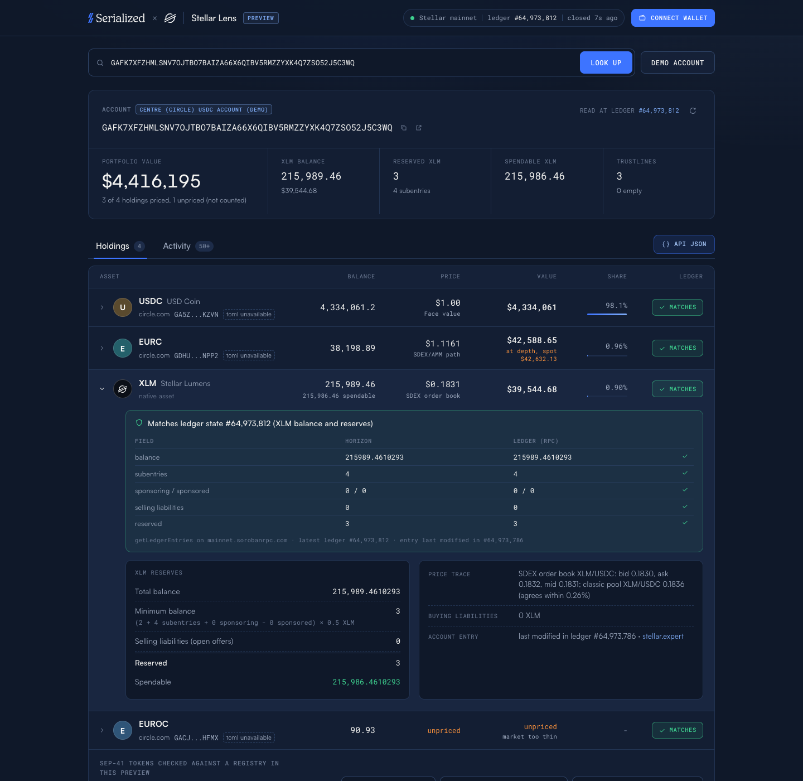

## What it shows

| Area | What you get | Mirrors |
| --- | --- | --- |
| Header | Live ledger ticker: "Stellar mainnet, ledger #N, closed Xs ago" | |
| Connect | Stellar Wallets Kit modal (all default modules: Freighter, xBull, Albedo, LOBSTR, Rabet, Hana...). Read-only: Lens reads the public key and never asks to sign a transaction. Also an address field for `G...` and muxed `M...` addresses, and a demo account. | |
| Holdings | XLM with total, reserved and spendable amounts; every trustline with code, issuer, home domain, SEP-1 verification, flags (authorized, clawback), balance, USD price, value and price source; CAP-38 pool shares split into their two reserves; SEP-41 tokens from a small registry; total portfolio value. | `GET /v1/wallet/positions` |
| Verify | One button per row: reads the account, trustline or pool entry straight from Stellar RPC `getLedgerEntries` (a SEP-41 balance by a fresh `balance()` simulation) and shows "ledger state #N, matches", a newer ledger state, an RPC node behind the data shown, or a mismatch. | |
| Activity | Payments, path payments and Soroban contract swaps (one swap row each, with what left and what arrived), account creation and merges (with the merged amount), SAC transfers, mints and burns, pool deposits and withdrawals (operations view), memos (text, id, hash), counterparty, time, stellar.expert link, cursor pagination. | `GET /v1/wallet/transfers`, `GET /v1/wallet/swaps` |
| API drawer | The exact JSON our API would return for this account (one page, as the API serves it), with copy to clipboard. | the three endpoints above |

URL parameters make every state linkable: `?address=G...&tab=activity&feed=operations&api=1&endpoint=transfers`; `&expand=XLM,EURC` (or `all`) opens holding rows and `&verify=1` runs Verify on the first 10 of them; `?connect=1` opens the wallet picker.

## Screenshots

| | |
| --- | --- |
| 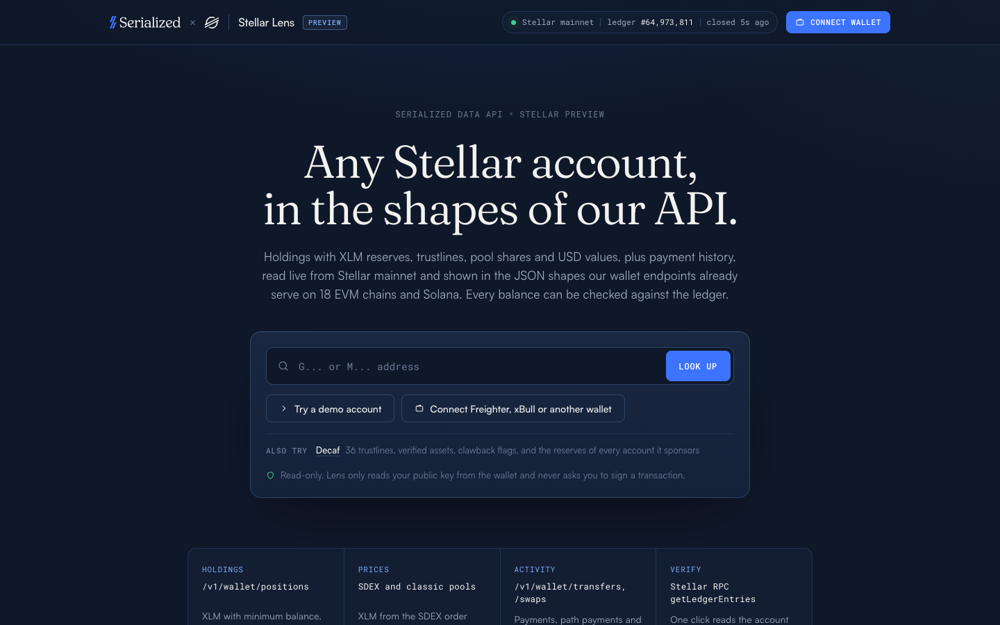 | 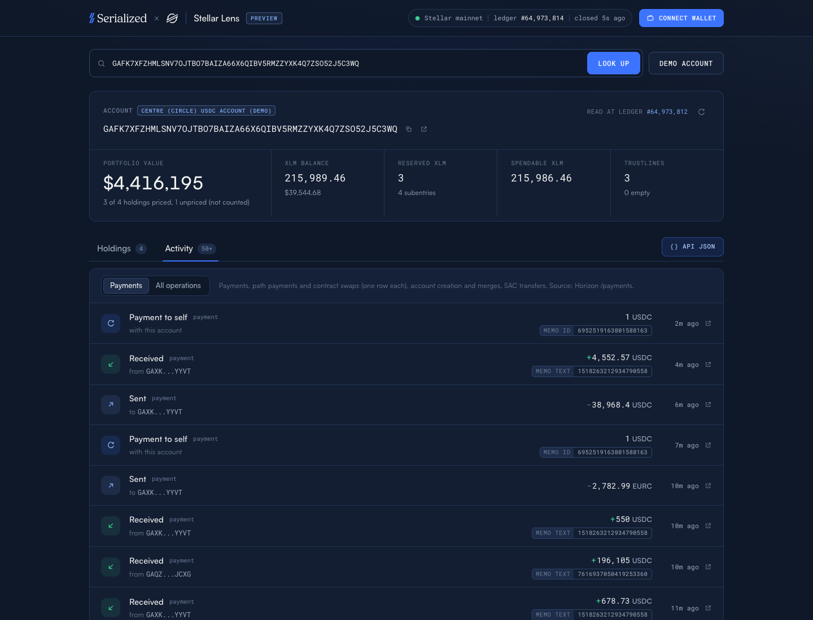 |
| Home | Activity of the demo account |
| 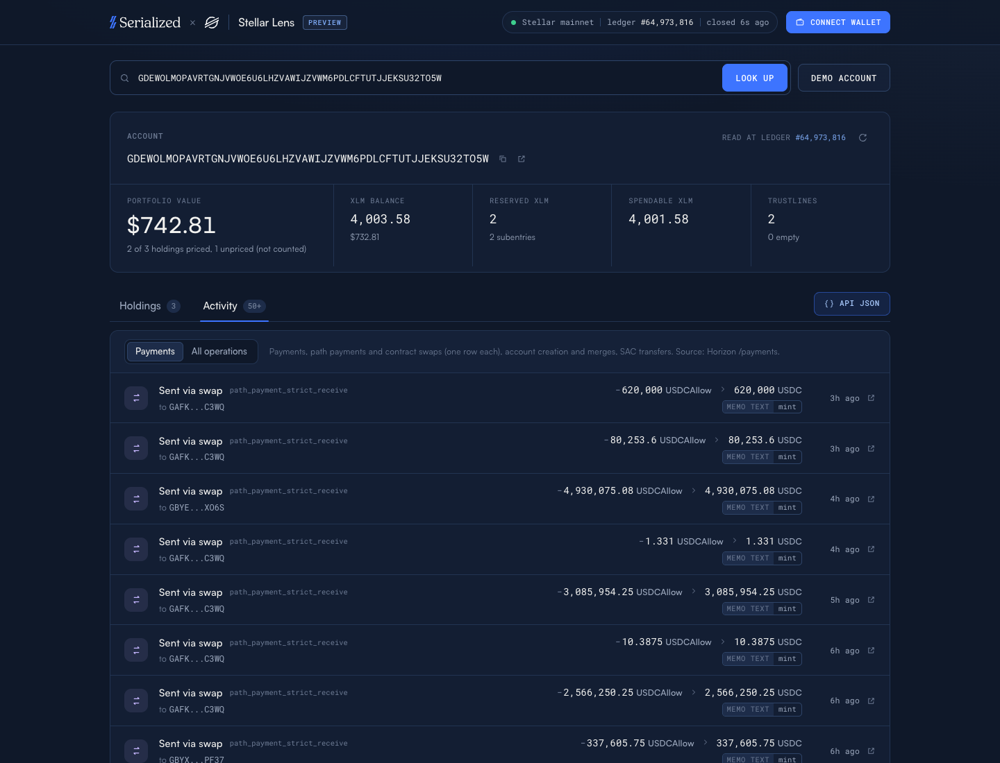 | 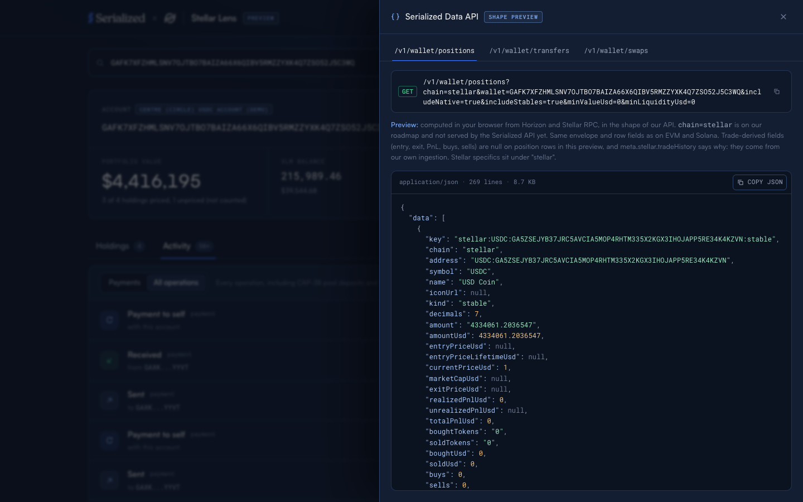 |
| Path payments, one swap row each | API drawer: `/v1/wallet/positions` |
| 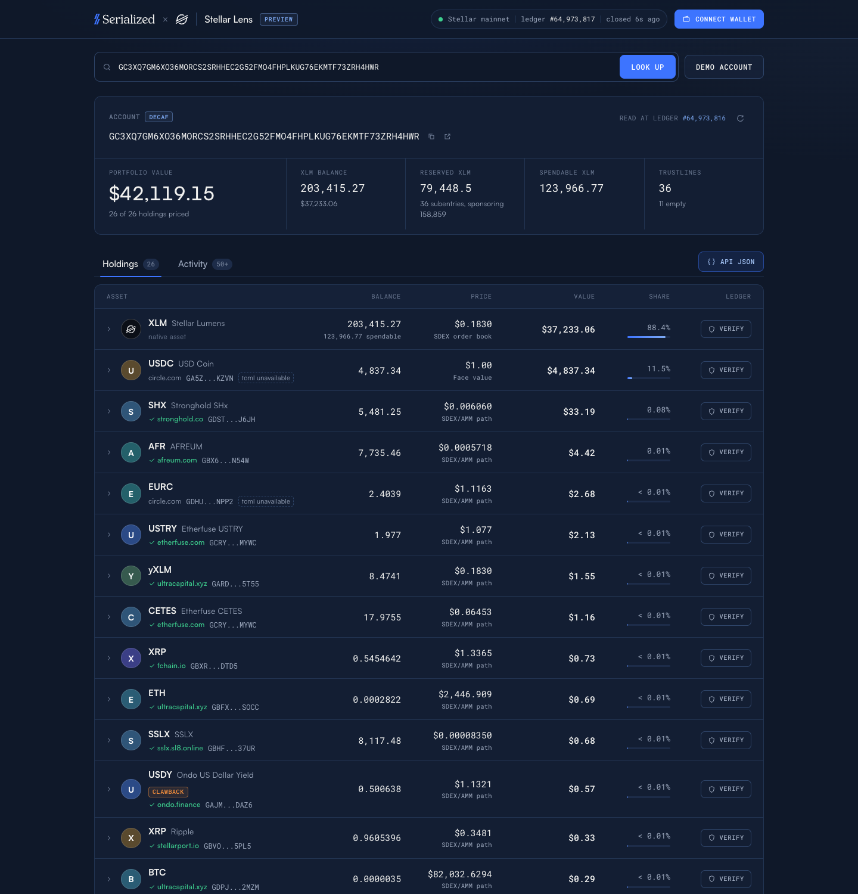 | 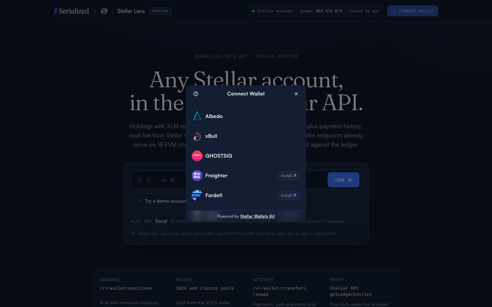 |
| A custodian with 36 trustlines, SEP-1 verified assets and the reserves of the accounts it sponsors | Stellar Wallets Kit picker |
| 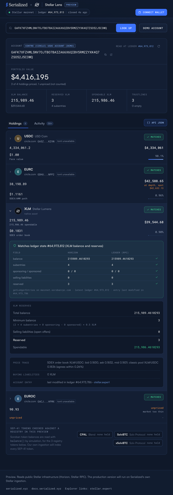 | 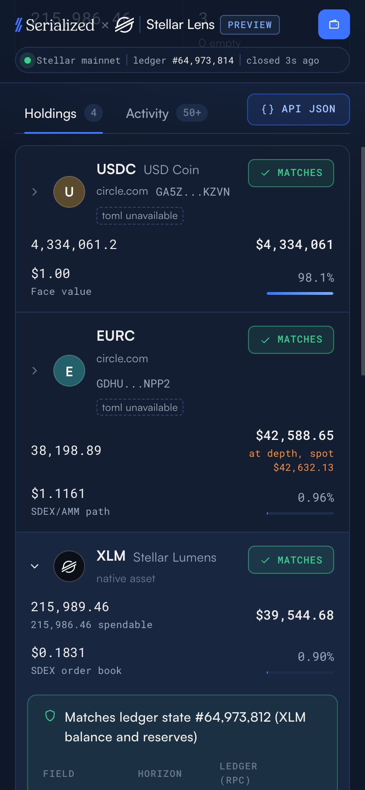 |
| Tablet, 820 px: holdings as cards | Mobile, 390 px: holdings |
| 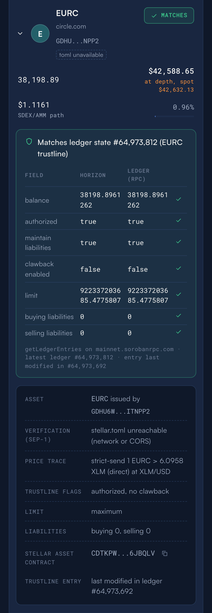 | 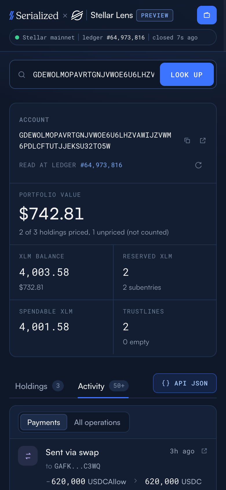 |
| Mobile, 390 px: a trustline verified field by field | Mobile, 390 px: path payments |

Also: [home at 375 px](docs/screenshots/mobile-home.png), [API drawer at 390 px](docs/screenshots/mobile-api.png), [muxed address](docs/screenshots/muxed.png), [operations feed](docs/screenshots/ops.png), [transfers JSON](docs/screenshots/api-transfers.png), [account not found](docs/screenshots/not-found.png).

## Demo account

`GAFK7XFZHMLSNV7OJTBO7BAIZA66X6QIBV5RMZZYXK4Q7ZSO52J5C3WQ`, a **Centre (Circle) USDC account** on Stellar mainnet.

Why this account:

- **A known organisation, not a person.** The moderated [stellar.expert directory](https://stellar.expert/explorer/public/directory) labels it "Centre" (centre.io, the USDC consortium now part of Circle; tag: anchor). It receives USDC mints, as path payments with memo `mint`, from `GDEWOLMO...SU32TO5W`, an account that [centre.io/.well-known/stellar.toml](https://centre.io/.well-known/stellar.toml) lists. The stellar.toml does not list the demo account itself; its activity (payouts, deposits with memos, a 1 USDC payment to itself every few minutes) is that of an operational account.
- **Several assets:** XLM, USDC, EURC and the legacy EUROC, so the page shows a native row, a face-value stablecoin, an asset priced through SDEX paths, and an asset that stays unpriced with its reason.
- **Very active:** balances move every few minutes, which exercises the "newer ledger state" branch of Verify.

The demo has no CAP-38 pool share: none of the organisations in the stellar.expert directory held one in the XLM/USDC, XLM/AQUA, XLM/EURC, EURC/USDC or AQUA/USDC pools when checked (2026-10-16). The pool share code path is covered by the live test, on a liquidity provider picked at run time from Horizon's pool participants (no address is hard-coded).

The home page also offers a second example: `GC3XQ7GM...ZRH4HWR`, labelled **Decaf** in the stellar.expert directory (decaf.so, tag: custodian): 36 trustlines, SEP-1 verified assets, clawback-enabled assets, and a large reserve from the accounts it sponsors.

## How it works

Everything runs in the browser (or in node for the tests). No Serialized host is called.

| Source | Used for |
| --- | --- |
| Horizon `https://horizon.stellar.org` | `/accounts/{id}` (balances, flags, subentries, sponsorship counters), `/ledgers` (base reserve), `/liquidity_pools/{id}`, `/accounts/{id}/payments?join=transactions`, `/accounts/{id}/operations?join=transactions`, `/operations/{id}/effects` (merged amount of an account merge), `/` and `/ledgers/{seq}` (where Horizon's retained history starts), `/order_book`, `/paths/strict-send`, `/offers` |
| Stellar RPC `https://mainnet.sorobanrpc.com`, fallback `https://soroban-rpc.mainnet.stellar.gateway.fm` | `getHealth` (ledger ticker), `getLedgerEntries` (Verify), `simulateTransaction` (SEP-41 `balance()`, `decimals()`, `symbol()`, `name()`; nothing is ever submitted) |
| `https://{home_domain}/.well-known/stellar.toml` (SEP-1) | Issuer verification: a "verified" tick only when the issuer's stellar.toml lists that exact currency (code and issuer) |
| stellar.expert | Outbound links only |

The ticker uses `getHealth` (sequence and close time in about 200 bytes) rather than `getLatestLedger`, which on protocol 29 also returns the full ledger metadata (about 2.7 MB per call).

### Reserves

`minimum balance = (2 + subentry_count + num_sponsoring - num_sponsored) x base reserve`, with the base reserve read from the latest ledger header (0.5 XLM on mainnet). `reserved = minimum balance + selling liabilities`, `spendable = balance - reserved`. Empty trustlines are listed separately: each still uses a subentry (two for a pool share), whose reserve the account pays unless a sponsor does; the page says how much of this account's reserve they lock.

### Prices

- **USD unit:** Circle USDC (`USDC:GA5ZSEJY...KZVN`) at face value, 1 USD.
- **XLM/USD:** mid of the SDEX order book XLM/USDC. Guards: both sides present, spread at most 2%, price in a sane window, and agreement within 3% with the classic XLM/USDC pool. When that cross-check cannot run, the price trace says so.
- **Other classic assets:** Horizon strict-send paths toward USDC or XLM (SDEX offers and classic pools). A first probe of 1 unit sizes a second probe of about 10 USD of notional, which gives the unit price. Guards: no path, a 10 USD probe moving the price by more than 50%, or an absurd unit price all leave the asset **unpriced, with the reason shown**. A conversion filled by the USDC issuer's own mint offer (Circle's allowance token) is a mint facility, not a market, and is not used as a price.
- **Value at depth:** as the Serialized API values positions at the depth of their market, a holding worth more than 20 USD is valued at the proceeds of selling the whole balance in one path payment now; the page shows the spot value next to it.
- **Pool shares:** the account's share of each reserve (rounded down, as a withdrawal is), each valued at depth like a trustline holding. If one reserve is unpriced, the share is unpriced.
- **SEP-41 tokens:** shown with their balance, unpriced in this preview.

### Verify

The page data comes from Horizon; Verify reads the same entry from Stellar RPC and compares field by field: for XLM the balance, subentries, sponsorship counters, selling liabilities and reserved amount; for a trustline the balance, authorized, authorized to maintain liabilities, clawback, limit and both liabilities; for a pool share its shares and the pool's total shares and reserves. Outcomes:

- **Matches:** same values.
- **Changed:** the entry was modified in a later ledger than the one shown ("changed in ledger #N, after this page loaded").
- **RPC behind:** the RPC node answered with an older version of the entry than the one shown; retry.
- **Mismatch:** same entry version, different values. Only this is reported as a discrepancy.

A SEP-41 balance is checked with a fresh `balance()` simulation, never a cached one.

### SEP-41 registry

Soroban-native tokens checked with `balance()` by simulation. The Stellar Asset Contracts of the account's own trustlines are not checked: they mirror the trustline balance already read.

| Symbol | Contract | Project | Sources |
| --- | --- | --- | --- |
| CPAL | `CAS3FL6TLZKDGGSISDBWGGPXT3NRR4DYTZD7YOD3HMYO6LTJUVGRVEAM` | Blend (BLND:USDC Comet LP, backstop token) | `blend-capital/blend-utils` mainnet.contracts.json ("comet"); stellar.expert directory |
| SolvBTC | `CBIJBDNZNF4X35BJ4FFZWCDBSCKOP5NB4PLG4SNENRMLAPYG4P5FM6VN` | Solv Protocol | stellar.expert directory (solv.finance); docs.k2lend.com/contracts |
| xSolvBTC | `CAUP7NFABXE5TJRL3FKTPMWRLC7IAXYDCTHQRFSCLR5TMGKHOOQO772J` | Solv Protocol | stellar.expert directory (solv.finance); docs.k2lend.com/contracts |

Each id was also checked on mainnet: a WASM contract whose `symbol()` and `decimals()` match. The live test re-checks the symbols on every run.

### Gentle use of public infrastructure

- In-memory cache per response (ledger 4 s, account 5 to 10 s, payments 15 s, paths 60 s, pools 30 s, issuers 10 min, operation effects 1 h, stellar.toml and SEP-41 `decimals()`/`symbol()`/`name()` for the session) and de-duplication of identical in-flight requests.
- At most 4 concurrent Horizon requests, 2 RPC requests and 3 stellar.toml fetches.
- Ledger ticker every 5 s at most, only while the tab is visible, with backoff up to 60 s after failures.
- Bounded retries (2, exponential backoff with jitter) on network errors and 5xx only. A 429 is never retried: that endpoint family is paused until its rate-limit window resets, and the affected rows say "rate limited".
- Activity pages of 50 records with Horizon cursors; the merged amount is read for at most 20 account merges per page.
- Per account, at most 40 holdings are priced (USDC first, then pool shares, then real balances largest first, then dust of a few stroops) and 60 trustlines SEP-1 checked. A holding beyond that budget reuses a price already computed on the page when its balance needs no depth check; the rest show "not priced" with that reason and a notice, instead of firing hundreds of path-finding requests.
- `&verify=1` checks at most 10 rows, once per load.
- An issuer's `home_domain` is only fetched when it is a public DNS hostname (no IP, no port, no `localhost`), and never on a Serialized domain.
- Opening the wallet picker loads wallet icons from `stellar.creit.tech`, `uni.onekey-asset.com`, `scopuly.com` and `storage.herewallet.app`; choosing Albedo opens `albedo.link`, which signs a random token to prove the key belongs to the user (never a transaction).

## The JSON shapes

Field names, order and envelope follow the Serialized API reference (docs.serialized.xyz, `openapi.json` and the endpoint pages). Stellar-specific fields live under a `stellar` sub-object on each row; the chain id is `stellar`; asset addresses use the SEP-11 form `CODE:ISSUER` (`native` for XLM), pool shares the pool id, SEP-41 tokens the contract id. USD figures are not rounded, as the API serves them.

`GET /v1/wallet/positions?chain=stellar&wallet=G...&includeNative=true&includeStables=true&minValueUsd=0&minLiquidityUsd=0` (excerpt):

```json
{
  "data": [
    {
      "key": "stellar:native:native",
      "chain": "stellar",
      "address": "native",
      "symbol": "XLM",
      "name": "Stellar Lumens",
      "iconUrl": null,
      "kind": "native",
      "decimals": 7,
      "amount": "215989.4610493",
      "amountUsd": 39625.0809409669,
      "currentPriceUsd": 0.1834584,
      "realizedPnlUsd": 0,
      "buys": 0,
      "labels": [],
      "share": 0.8972501576387168,
      "stellar": {
        "assetType": "native",
        "reserves": {
          "total": "215989.4610493",
          "minimumBalance": "3",
          "sellingLiabilities": "0",
          "buyingLiabilities": "0",
          "reserved": "3",
          "spendable": "215986.4610493",
          "baseReserve": "0.5",
          "subentryCount": 4,
          "numSponsoring": 0,
          "numSponsored": 0
        },
        "priceSource": "sdex_orderbook_mid",
        "priceDetail": "SDEX order book XLM/USDC: bid 0.1834, ask 0.1835, mid 0.1835; classic pool XLM/USDC 0.1840 (agrees within 0.30%)",
        "unpricedReason": null,
        "explorerUrl": "https://stellar.expert/explorer/public/account/GAFK7XFZHMLSNV7OJTBO7BAIZA66X6QIBV5RMZZYXK4Q7ZSO52J5C3WQ"
      }
    }
  ],
  "meta": {
    "asOf": 1792154609537,
    "summary": { "totalValueUsd": 4416280.187149567, "realizedPnlUsd": null, "unrealizedPnlUsd": null, "totalPnlUsd": null, "positions": 4, "valued": 3 },
    "hasMore": false,
    "stellar": { "account": "GAFK7XFZ...J5C3WQ", "muxedId": null, "ledger": 64973765, "baseReserve": "0.5", "emptyTrustlines": 0, "tradeHistory": "not_indexed_in_preview", "preview": true }
  }
}
```

Every row carries all 32 fields of the API row in the API's order (the excerpt above drops some for length). Trustline rows add `stellar.code`, `issuer`, `homeDomain`, `verified`, `verification`, `sacContractId` and `trustline` (`authorized`, `authorizedToMaintainLiabilities`, `clawbackEnabled`, `limit`, liabilities, `sponsor`, `lastModifiedLedger`). Pool share rows add `poolId`, `feeBp`, `totalShares`, `sharePercent`, `reserves` (`asset`, `poolAmount`, `amount`, `priceUsd`, `amountUsd`, `valueAtDepthRatio`) and a `trustline` without authorization flags: under CAP-38 a pool-share trustline has none, its authorization follows the trustlines of the two pool assets.

Differences with the API on EVM and Solana, all due to the preview reading public infrastructure:

- Trade-derived fields (`entryPriceUsd`, `exitPriceUsd`, PnL, `boughtTokens`, `buys`, `firstTradeAt`, `holdingSince`, fees) are `null` on `position` rows, and so are the PnL totals of `meta.summary`; `meta.stellar.tradeHistory: "not_indexed_in_preview"` says why. They come from a wallet's full trade history, which our own ingestion will provide; `0` would claim "never traded". Native and stable rows carry the zeros the API serves for them.
- `marketCapUsd` and `iconUrl` are `null`.
- `amountUsd` on transfers is only filled for Circle USDC (face value): historical prices come with our own ingestion.
- A transfers or swaps page covers 50 Horizon operations, where the API's `limit` counts transactions.

`GET /v1/wallet/transfers?chain=stellar&wallet=G...&limit=50` (one row):

```json
{
  "data": [
    {
      "at": 1792141387000,
      "chain": "stellar",
      "txHash": "7b5c80ac4bad7543805df5f8c31af8473fd565ea781eab5b7e1b867a167bfe02",
      "direction": "out",
      "tokenAddress": "USDCAllow:GDIEKKIQWMIZ4LD3RP3ABPN7X5KEAEWYMR634BRHB7EULIMEVREWLF3G",
      "tokenSymbol": "USDCAllow",
      "amount": "620000",
      "amountUsd": null,
      "counterparty": "GAFK7XFZHMLSNV7OJTBO7BAIZA66X6QIBV5RMZZYXK4Q7ZSO52J5C3WQ",
      "stellar": {
        "operationId": "279048839879671809",
        "operationType": "path_payment_strict_receive",
        "memo": { "type": "text", "value": "mint" },
        "fromMuxedId": null,
        "toMuxedId": null,
        "ledger": 64971121,
        "conversion": {
          "sourceAsset": "USDCAllow:GDIEKKIQWMIZ4LD3RP3ABPN7X5KEAEWYMR634BRHB7EULIMEVREWLF3G",
          "sourceAmount": "620000",
          "destinationAsset": "USDC:GA5ZSEJYB37JRC5AVCIA5MOP4RHTM335X2KGX3IHOJAPP5RE34K4KZVN",
          "destinationAmount": "620000",
          "path": []
        },
        "contract": null,
        "explorerUrl": "https://stellar.expert/explorer/public/op/279048839879671809",
        "supplyEvent": null
      }
    }
  ],
  "meta": {
    "asOf": 1792154610412,
    "hasMore": true,
    "nextCursor": "279056935892819969",
    "oldestAt": 1792151112000,
    "historyFrom": 1756362906000,
    "stellar": { "source": "horizon_payments", "pageUnit": "operations", "muxedId": null, "preview": true }
  }
}
```

- **Transfers** are every token movement in or out of the account, one row per asset moved. As in the API, a transaction that only swapped adds no row, and a payment to self adds none. A path payment to another account is a transfer carrying `stellar.conversion`. `stellar.supplyEvent` is `mint` for a payment from the asset's issuer, `burn` for one back to it (and `clawback` when a contract event says so); the counterparty stays the issuer. `meta.historyFrom` is the earliest instant Horizon serves (its oldest retained ledger), so `hasMore: false` means "no older record on Horizon", not "no older history on the ledger".
- **Swaps** are the account's own swaps, one row per transaction: path payments whose source and destination are both the account, and Soroban contract calls that took one asset from the account and paid it another (AMM and aggregator swaps through Stellar Asset Contracts, with `stellar.operations[].contract`). `sent` and `received` are netted across the transaction's legs, so an asset that only passes through cancels out. `feesNative` is the fee this account paid for the transaction (`0` when a channel or fee-bump account paid it; `stellar.feePaidBy` says who). `route` is an empty array: per-hop venues come from trade effects and contract events, read by our own ingestion. `meta.usdBasis` is `usdc_face_value`: `volumeUsd` is the USDC side of the swap, when there is one.
- With a muxed `M...` address, a payment between two muxed ids of the same account reads `in` or `out` relative to the muxed id entered; both ids are on every row (`stellar.fromMuxedId`, `stellar.toMuxedId`).

## Run it

Requirements: Node 24 and pnpm 10.

```bash
pnpm install          # exact versions from pnpm-lock.yaml
pnpm dev              # http://localhost:5173
pnpm build            # tsc --noEmit, then vite build into dist/
pnpm preview          # serve dist/ on http://localhost:4173
pnpm test             # node tests/live.test.ts, against Stellar mainnet
```

`dist/` uses relative asset paths (`base: "./"`), so it can be served from any path, GitHub Pages included.

### Live test

`tests/live.test.ts` runs with node's built-in type stripping (no test runner). Against mainnet, for the demo account, Circle's mint account and the Decaf account, it checks that (a) the positions JSON matches the API schema (field list and order copied from the API reference, every field's type as the server types it with the preview's agreed nulls, keys, unrounded USD, shares summing to 100%), (b) every trustline balance and the XLM balance equal `getLedgerEntries` (re-reading when an entry changed between the two reads), (c) the reserves math holds against the ledger entry, and (d) every path payment renders as exactly one swap row with the right assets and amounts. It also checks the muxed address parsing and muxed directions, the XLM price guards, the four Verify outcomes on a quiet trustline, the SEP-41 registry symbols, a CAP-38 pool share split and verified on a liquidity provider picked at run time, contract swaps (offline, and on a mainnet account found at run time), the merged amount of an account merge found at run time, Horizon's history floor, the home-domain guard, and fee attribution. A test that finds nothing to check on the network at that moment reports SKIP, never a pass.

## Limits of this preview

- **SEP-41 tokens** are only found when they are in the registry above. Our own ingestion indexes every token contract.
- **Prices** come from Horizon path finding over SDEX and classic pools at the moment of the request. Soroban AMMs (Aquarius, Soroswap, Phoenix...) are not priced here, so assets traded only there show as unpriced. Single-path depth undervalues balances that a split execution could sell better.
- **History depth:** public Horizon keeps about one year of history (from 2025-08-28 when checked on 2026-10-16); older operations are not served, and `meta.historyFrom` says where it starts. There is no historical USD valuation of past transfers.
- **Contract swaps** are recognised from the Stellar Asset Contract balance changes Horizon reports: a leg in a Soroban-native token (not a classic asset) is not visible in this preview.
- **Claimable balances:** a balance created for this account shows in the operations feed without its amount, and claimed balances do not reach the transfers JSON (claims are not in Horizon's payments record).
- **SEP-1:** a stellar.toml that lists its currencies through a linked `toml=` file is not followed, so such assets show "not in stellar.toml".
- **Holdings** are read once per load (no streaming). The production version will stream updates at ledger close.
- **Rate limits:** the public Horizon instance limits path-finding requests per IP. When the limit is hit, the affected rows say so and pricing resumes after the window.

## Roadmap

The production version replaces every public read with Serialized's own Stellar ingestion: complete holdings from ledger state (trustlines, SAC and every SEP-41 balance, CAP-38 shares), one history across classic operations and Soroban events, USD prices for every asset from SDEX, classic pools and Soroban AMM trades, candles, and streams at ledger close, served on the same `/v1/wallet/*` endpoints with `chain=stellar`. See [serialized.xyz](https://serialized.xyz) and [docs.serialized.xyz](https://docs.serialized.xyz).

## Tech notes

- Vite 8, React 19, TypeScript 5.9 (strict), plain CSS, `@stellar/stellar-sdk` 17.2.1, `@creit.tech/stellar-wallets-kit` 2.7.0. All versions are exact; `pnpm-workspace.yaml` sets `minimumReleaseAge: 20160` (14 days) for direct and transitive dependencies, and package build scripts are not run.
- The data layer (`src/data/`) is plain TypeScript with no UI dependency, runnable in the browser and in node.
- React types: `@types/react` is not installed; `src/types/react-shim.d.ts` declares the subset of React used here. Deleting it after adding `@types/react` is enough.
- The wallet kit is loaded on first use, in its own chunks.

## License

None yet.
